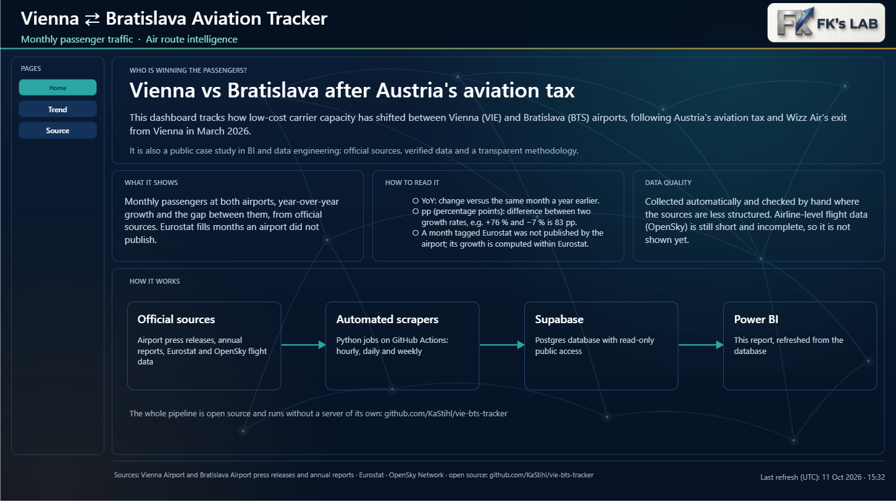
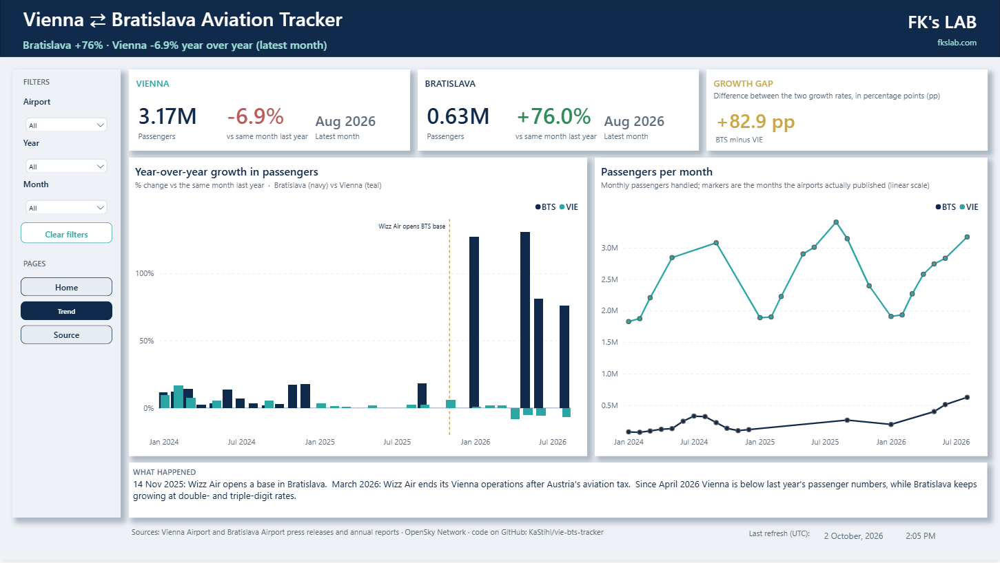
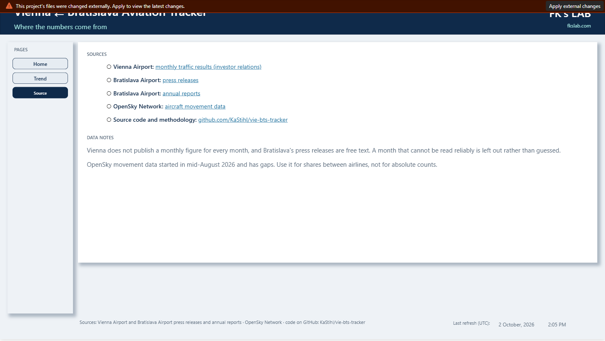

# Power BI report: VIE-BTS.pbix

## Files

| Path | What |
|---|---|
| `VIE-BTS.pbip`, `VIE-BTS.Report/`, `VIE-BTS.SemanticModel/` | the report project (source of truth): report as PBIR JSON, model as TMDL |
| `VIE-BTS.pbix` | previous snapshot of the report (old design) |
| `powerquery/` | ready-to-paste Power Query for the REST data source (see "Switch the data source") |
| `tools/model-fixes-2026-10.ps1` | the script that applied the October-2026 model fixes through the Desktop's local Analysis Services port |
| `tools/patch_report.py` | idempotent patcher for report-layer text/visual fixes inside the `.pbix` |
| `fnSupabase.m` | the first draft of the REST function (superseded by `powerquery/fnSupabase.m`) |

## Model

```
Airport (VIE, BTS) 1 --> * public monthly_traffic   --> DateTable (date table)
                   1 --> * public annual_traffic
                   1 --> * public carrier_movements --> DateTable
public airports  1 --> * public carrier_movements   (origin ICAO active, other_airport inactive)
_Measures  = measure container (typo kept on purpose, see below)      Query = refresh timestamp
```

### Fixed in October 2026

| # | Problem | Fix |
|---|---|---|
| 1 | `monthly_traffic` and `annual_traffic` were related to `airports` on `VIE`/`BTS` = `icao_code` (`LOWW`/`LZIB`): the join matched **0 rows** | removed; new `Airport` dimension related on the short code |
| 2 | `Date` = `DATE(year, month, 1)`: rows with an unresolved month became `DATE(y, 0, 1)` = **December of the previous year**, adding phantom spikes (e.g. BTS Dec-2024 showed +273,807) | blank date when the month is NULL |
| 3 | `[WoW %]` divided by 100 twice (showed 0.10 % instead of 10.3 %) | fixed |
| 4 | `[YoY Change PAX %]` summed percentages and was blank for every month without a published %, e.g. all of BTS 2019-2024 | uses the airport's published % for one month; otherwise computes it from the same month a year earlier; never sums percentages. Cross-checked: computed Jun-2024 13.9 % vs published "14 %", Aug-2024 3.3 % vs "three percent" |
| 5 | `[Rozdiel v trende]` was `ABS(BTS - VIE) / 100` formatted as %, from different months when one airport published later | signed gap in **percentage points**, same month for both airports |
| 6 | Cards "Latest" could compare different months silently | added `[VIE Latest Month]`, `[BTS Latest Month]` |
| 7 | No view of how complete the OpenSky data is | `[Capture Coverage %]` (≈47 % in Oct 2026), `[Departure Hours With Data]`, `[Last Movement Captured]` |
| 8 | `DateTable` not marked as date table; `rows`, `rows2`, `rows3` junk measures; unused `_num` column; id/year/% columns summing by default; technical columns visible | cleaned up; percent columns formatted as literal `%` |

**Rename `_Measures` -> `_Measures` in Power BI Desktop** (Model view). It is a typo, but report
visuals reference the name, and only Desktop can rename it *and* update the visuals.

### Re-applying / auditing

`tools/model-fixes-2026-10.ps1 -Port <n>` is idempotent. Port: Desktop must have the report
open; `Get-NetTCPConnection -State Listen -OwningProcess (Get-Process msmdsrv).Id`.
Re-export the TMDL snapshot after model changes and commit it.

## Switch the data source to the Supabase REST API (fixes the stale "Last refresh")

The Power BI **service** cannot validate Supabase's private CA when connecting to Postgres, so
scheduled refresh fails and the published report keeps showing old data (on 10 Oct 2026 the
latest movement was 28 Sep, "Last refresh" 2 Oct). The REST API has a normal certificate.

Prerequisite: run `scraper/supabase_public_read.sql` once in the Supabase SQL editor
(read-only RLS policies for the `anon` role).

In Power BI Desktop -> **Transform data**:

1. **Manage parameters -> New parameters** (type Text, required):
   * `SupabaseUrl` = `https://xgvjeaymmmbffjltsgvi.supabase.co`
   * `SupabaseAnonKey` = the **anon / publishable** key (Supabase -> Project Settings -> API).
     It is a public key, but keep it out of git: it lives only in the parameter.
2. New blank query `fnSupabase` -> Advanced Editor -> paste `powerquery/fnSupabase.m`.
3. For each of `public monthly_traffic`, `public annual_traffic`, `public carrier_movements`,
   `public airports`, and `Query`: open **Advanced Editor** and replace the whole query with the
   matching file in `powerquery/`. Output columns keep their names, so measures and visuals
   keep working. When asked for credentials choose **Anonymous**.
4. **Close & Apply**, check the numbers, **Save**.
5. Publish, then in the service: dataset -> Settings -> **Scheduled refresh** (daily is plenty;
   data credentials: Anonymous; privacy level: Public). The key can be rotated there under
   "Parameters" without republishing.

What the new queries also change: `monthly_traffic` only loads rows with a resolved month and
`verified = 1`; `carrier_movements` times are converted to UTC so `Hour` means the same in
Desktop and in the service; `airports` loads only airports with an IATA code (~9k rows instead
of 86k, which would need 86 REST calls per refresh).

> I could not run these queries against the live API (the anon key is not in the repo), so the
> first Desktop refresh is the test. If the REST row cap bites (default 1,000 rows per request),
> raise **Max rows** in Supabase -> Settings -> API and increase `PageSize` in `fnSupabase`.

## Report design (Power BI Project, `VIE-BTS.pbip`)

Open **`VIE-BTS.pbip`** (not the `.pbix`). A Power BI Project stores the report (`VIE-BTS.Report`, PBIR JSON)
and the model (`VIE-BTS.SemanticModel`, TMDL) as plain text, so changes show up as git diffs and can be made
outside Desktop. The `.pbix` is kept only as the previous snapshot.

| Home | Trend | Source |
|---|---|---|
|  |  |  |

**What it is:** a dark "glass card" design on a generated route-network background, the FK's LAB logo in the
header, one footer on every page, and native visuals only (no text is baked into a picture).

* **Trend:** one KPI card per airport (passengers, change vs the same month last year, month, previous release and
  its change), a growth-gap card, one growth chart per airport on its own axis (declines in red), a passengers
  chart on a linear axis, and a three-step timeline of what happened.
* **Home:** introduction, how to read the report (YoY, percentage points), data quality, and a "how it works" diagram.
* **Source:** one card per source with working links, plus data notes.

Checks applied (dataviz / design-critique / accessibility):
* series colours validated with the dataviz palette validator on the card surface (dark mode):
  Bratislava `#2CA6A4`, Vienna `#BC862B` - colour-blind distance 15, normal-vision distance 19, contrast >= 3:1;
* text never wears a series colour (a thin accent bar above a card carries identity); text contrast on the card:
  white 15:1, light 10:1, muted 6.9:1, green 8.6:1, red 6.0:1 (WCAG AA);
* no dual axis, no trend line, recessive dashed grid, legend where there are two series, alt text on charts and cards;
* two airports with very different scales get two charts (Vienna's -8 % stays readable next to Bratislava's +150 %).

The old pages are still in the report, renamed "... (old design)" and hidden.

### Generating / changing the pages

The pages are generated, not hand-drawn, so the design is reviewable and repeatable:

```
pip install pillow
python PBI/tools/build_report.py            # measures + background pictures + Home, Trend, Source (optional arg: page id to open first)
```

`tools/make_backgrounds.py` draws the background pictures (decoration only). Close Desktop first. The scripts write
text files only; every file is valid against Microsoft's PBIR schemas, and Desktop is the final judge, so after a
change open the project and look.

Things learned getting it to load and render (so nobody has to rediscover them):
* **A visual title/subtitle bound to a measure (`title.text = Measure`) makes Desktop fail with "Failed to load
  the report".** Titles are static; dynamic values are callouts inside the card.
* **A shape with fill transparency or an outline renders nothing.** Shapes use a solid fill; the border and rounding
  come from the visual container (like on charts and cards).
* **A column chart with a legend field cannot be coloured by value, and a measure-driven `fill` on columns is
  ignored** (theme colours appear). Colour by sign instead with separate growth/decline measures and fixed colours.
* Editing the `.pbix` archive from outside Desktop did not work (Desktop rejected two rebuilt archives as corrupted
  although the content was schema-valid); that is why the project uses `.pbip`. `tools/patch_report.py` is kept only
  for reference.
* Windows path length (260 chars) bites when copying the project into deep folders.
* Keep local-only files out of git: `.pbi/cache.abf` (data cache) and `.pbi/localSettings.json`.

Known leftovers: the hidden work-in-progress pages ("BTS Operations (WIP)" references a measure that no longer exists,
`Ryanair Share Trend Check`; "Carrier Analysis (WIP)").
